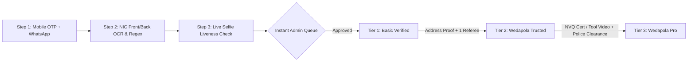
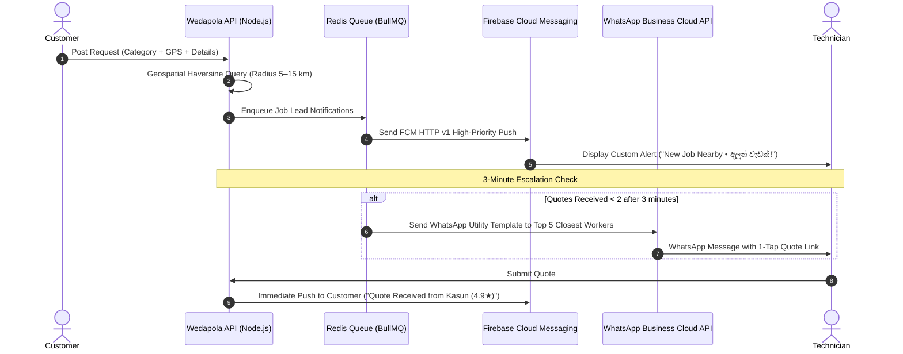

# Wedapola (Fixora) — Production Implementation & Architecture Plan

**Wedapola** (*"වැඩකට කෙනෙක්. කෙනෙකුට වැඩක්."*) is a location-based on-demand home, commercial, and outdoor service marketplace optimized for the Sri Lankan market and fully compatible with the **EKAFY** multi-tenant containerized hosting platform.

---

## 1. EKAFY Architectural & Hosting Compatibility

Wedapola is built to run natively within the **EKAFY containerized ecosystem**:

```mermaid
graph TD
    Traefik[Traefik Reverse Proxy (SSL / Dynamic Labels)] -->|Host: wadapola.ekafy.com| App[Wedapola Node.js App (:3000)]
    App -->|mysql2/promise pool| MariaDB[(Tenant MariaDB: db_tenant_wedapola)]
    App -->|BullMQ Queue| Redis[(EKAFY Redis: ekafy-redis)]
    App -->|Push / HTTP v1| FCM[Firebase Cloud Messaging]
    App -->|Template API / Fallback| WhatsApp[WhatsApp Business Cloud API]
    App -->|Storage Abstraction| Storage[Local Volume / Cloudflare R2]
```

### Mandatory EKAFY Standards Compliance:
1. **Network & Routing**:
   - Container listens on `0.0.0.0:3000` via `process.env.PORT || 3000`.
   - Connected to internal bridge network `ekafy-network`.
   - Dynamic SSL routing via Traefik labels (`traefik.http.routers.wedapola.rule=Host(...)`).
2. **Container Build**:
   - Multi-stage Dockerfile (`node:20-alpine AS builder` + `runner`).
   - Native compilation tools (`python3`, `make`, `g++`, `libc6-compat`).
   - Strict adherence: **Zero** installation of `@types/mysql2` (bundled directly in `mysql2`).
3. **Database Standards**:
   - Character Set: `utf8mb4` with `utf8mb4_unicode_ci` collation.
   - Idempotent table schemas (`CREATE TABLE IF NOT EXISTS`).
   - Connection pool via `mysql2/promise` with strict parameterized queries.
4. **Tenant Configuration**:
   - Master configuration loaded from `.env` with documentation in `.env.example`.
   - Multi-tenant database naming: `db_tenant_wedapola` with host `ekafy-mariadb`.

---

## 2. Sri Lankan Market Service Taxonomy & Category Hierarchy

Wedapola supports both **Instant Quote Dispatch** (for emergencies) and **Inspection/Photo-Based Custom Quotations** across 6 core sectors:

### 1. Garden, Tree & Estate Work (ගෙවතු, ගස් කැපීම සහ වතු පිටි නඩත්තුව)
*High frequency & urgent demand in Sri Lanka for daily-wage outdoor labor:*
- **Tree Pruning & Felling (ගස් වල අතු කැපීම සහ ගස් කැපීම)**: Trimming hazard branches near roofs/CEB power lines, tree removal.
- **Grass Cutting & Lawn Care (තණකොළ කැපීම සහ ගෙවතු පිරිසිදු කිරීම)**: Brush cutter (වල් කපන මැෂින්) clearing, weeding, mowing.
- **Coconut Plucking & Estate Care (පොල් කැඩීම සහ පොල් වතු නඩත්තුව)**: Harvesting coconuts, tree-crown cleaning, salt/fertilizer application.
- **Landscaping & Drainage (ගෙවතු අලංකරණය සහ කාණු සුද්ධ කිරීම)**: Monsoon drain clearance, stone paving, hedge trimming.

### 2. Home & Commercial Cleaning (නිවෙස් සහ ව්‍යාපාරික ස්ථාන පිරිසිදු කිරීම)
*High repeat bookings before festivals (Awurudu, Christmas), weddings, and tenancy moves:*
- **Deep House Cleaning (නිවෙස් ගැඹුරින් පිරිසිදු කිරීම)**: Full house sweeping, mopping, cobweb/mold removal, kitchen/bath scrubbing.
- **Sofa, Mattress & Carpet Shampooing (සෝෆා, මෙට්ට සහ කාපට් පිරිසිදු කිරීම)**: Vacuum stain extraction and sanitization.
- **Water Tank & Roof Cleaning (වතුර ටැංකි සහ වහල පිරිසිදු කිරීම)**: Overhead/sump tank draining, scrubbing, and roof moss pressure washing.
- **Post-Construction Cleaning (ඉදිකිරීම් වලින් පසු පිරිසිදු කිරීම)**: Cement stain scraping, paint drop clearing, debris disposal.

### 3. Vehicle Repair & Mobile Auto Care (වාහන අලුත්වැඩියා සහ නඩත්තු)
*On-demand roadside and doorstep mechanical support:*
- **Mobile Mechanic / Breakdown Assistance (හදිසි වාහන අලුත්වැඩියාව)**: On-site car, van, three-wheeler, and bike diagnostics.
- **Battery Jumpstart & Replacement (බැටරි ආරෝපණය සහ මාරු කිරීම)**: Roadside jumpstart and doorstep battery installation.
- **Tire Puncture & Wheel Services (ටයර් පැච් දැමීම සහ මාරු කිරීම)**: Mobile tire repair and spare wheel fitting.
- **Auto Electrical & AC (වාහන විදුලි කාර්මික සහ A/C)**: Alternator, starter motor, fuse diagnostics, AC gas refilling.
- **Home Car Wash & Interior Detailing (නිවසට පැමිණ වාහන සේදීම)**: Mobile pressure washing and interior steam cleaning.

### 4. Core Technical Trades (ප්‍රධාන තාක්ෂණික ශිල්පීන්)
- **Electrical & Wiring (විදුලි කාර්මික)**: Trip switch / RCD troubleshooting, panel boards, fan/light installation, generator/solar connections.
- **Plumbing & Water Pumps (ජලනල සහ වතුර පොම්ප)**: Pipe leaks, bathroom tap fittings, pressure pump troubleshooting, drainage unblocking.
- **AC & Refrigeration (වායු සමීකරණ සහ ශීතකරණ)**: Split AC chemical wash, refrigerant gas refill, AC relocation, fridge repair.
- **Home Appliance Repair (ගෘහ විදුලි උපකරණ අලුත්වැඩියාව)**: Washing machines, microwave ovens, gas cookers, induction stoves.

### 5. Construction, Wood & Metalwork (ඉදිකිරීම්, වඩු සහ ලෝහ වැඩ)
*High-ticket inspection and multi-quote jobs:*
- **Masonry, Tiling & Waterproofing (පෙදරේරු, ටයිල් සහ වහල ලීක් වැසීම)**: Roof leak sealing, gutter repairs, bathroom tiling, plastering.
- **Carpentry & Aluminum (වඩු සහ ඇලුමිනියම් වැඩ)**: Door locks, hinges, furniture repairs, aluminum sliding windows, mosquito net installation.
- **Painting & Polishing (පින්තාරු සහ පොලිෂ් වැඩ)**: Interior/exterior house painting, wall putty skimming, wood varnishing.
- **Welding & Gate Repairs (වෑල්ඩින් සහ ගේට්ටු අලුත්වැඩියාව)**: Roller gate motor repairs, gate hinges, security grills, roof canopies.

### 6. General Labor & Moving Help (සාමාන්‍ය කම්කරු සහ බඩු ප්‍රවාහන සහාය)
- **House Shifting & Heavy Lifting (නිවෙස් මාරු කිරීම සහ බඩු එසවීම)**: Loading, unloading, shifting heavy appliances, packing.
- **General Handyman / Odd Jobs (සුළු අලුත්වැඩියා සහ විවිධ වැඩ)**: TV wall mounting, curtain rods, mirror hanging, minor repairs.

---

## 3. Fast-Track Tiered KYC for Worker Onboarding (< 5 Mins)

To prevent worker drop-off while guaranteeing household safety, Wedapola implements a 3-stage progressive trust verification model:



### Verification Tiers & Privileges:
| Tier Badge | Requirements | Unlocked Privileges |
| :--- | :--- | :--- |
| **Basic Verified** | • Mobile OTP (WhatsApp linked)<br>• Sri Lankan NIC (9V/X or 12 digits)<br>• Live Front-Camera Selfie (No gallery upload) | Outdoor jobs (grass cutting, coconut plucking, exterior yard work). |
| **Wedapola Trusted** | • Basic Verified<br>• Address Proof (CEB / LECO / Water bill or Grama Niladhari letter)<br>• 1 Guarantor / Referee phone verification | Indoor domestic jobs (plumbing, electrical, appliance repair, cleaning). Higher search ranking. |
| **Wedapola Pro** | • Trusted Verified<br>• NVQ Level 3/4 (NAITA / VTA) or tool verification video<br>• Police Clearance certificate (or application receipt) | High-ticket construction, commercial B2B contracts, top priority quote placement, featured profile. |

### Lean Security Measures:
- **Automatic Watermarking**: Stored NIC and certificate images are automatically watermarked: *"FOR WEDAPOLA VERIFICATION ONLY"*.
- **Private Storage**: Worker KYC documents are saved in private storage buckets and never served to client apps.
- **Probation Watch**: First 3 jobs of any newly verified technician trigger automated post-service follow-up calls or SMS confirmation.

---

## 4. After-Service Feedback & Worker Reputation Loop

To build word-of-mouth trust in Sri Lankan neighborhoods without burdensome forms:

### A. Rapid Customer Review Flow (< 15 Seconds)
1. **Star Rating**: 1 to 5 stars tap-to-rate.
2. **One-Tap Bilingual Behavior Chips**:
   - ⏱️ *On Time (වේලාවට පැමිණියා)*
   - 💰 *Fair Price / No Hidden Charges (සාධාරණ මිල)*
   - 🧹 *Clean & Neat Work (පිරිසිදු වැඩ)*
   - 🙏 *Polite & Respectful (විනීතයි)*
   - 🧰 *Brought Proper Tools (නිවැරදි උපකරණ තිබුණා)*
3. **Mandatory Photo Proof**:
   - Technician must upload a **Before & After photo** before tapping "Job Complete".
   - Customer confirms with one tap: *"Work looks good"*.

### B. Worker Future Success & Incentives
- **Hyper-Local Social Proof**: Worker profiles showcase badges like: *"Completed 24 jobs in Kandy / Peradeniya • 4.9★"*.
- **Commission Discounts**: Workers maintaining 4.8★+ across 10 jobs receive a 2% platform fee rebate.
- **"Hire Again" Shortcut**: Customers have a 1-tap rebooking shortcut on their home screen for recurring services (e.g., coconut plucking every 45 days, lawn mowing).
- **Shareable Digital Profile Card & QR**: Generates a web QR card for technicians to share with offline clients on WhatsApp.

### C. Worker Protection & Dispute Prevention
- **Two-Way Rating**: Technicians rate customers on courtesy, job scope accuracy, and prompt payment.
- **Quote-to-Final Bill Locking**: Customer must approve extra material costs within the app before work commences.
- **Low-Rating Quarantine**: 1-star or 2-star reviews are held in a 24-hour admin quarantine queue for verification before becoming public.

---

## 5. Dual-Channel Notification Engine (FCM + WhatsApp Fallback)

To ensure reliable delivery for field workers who may have mobile data disabled or are working on job sites:



### Technical Notification Architecture:
1. **Device Token Management**: `worker_devices` table stores FCM registration tokens, refreshed automatically on app launch.
2. **Android 13+ Setup**: Custom `NotificationChannel` with `IMPORTANCE_HIGH`, custom loud ringtone, and runtime `POST_NOTIFICATIONS` permissions.
3. **Haversine Geo-Dispatch**:
   ```sql
   SELECT w.id, w.name, w.phone, d.fcm_token,
          (6371 * acos(cos(radians(?)) * cos(radians(w.latitude)) * cos(radians(w.longitude) - radians(?)) + sin(radians(?)) * sin(radians(w.latitude)))) AS distance_km
   FROM technician_profiles w
   JOIN technician_services ts ON w.id = ts.technician_id
   JOIN worker_devices d ON w.id = d.worker_id
   WHERE ts.category_id = ?
     AND w.is_available = 1
     AND w.verification_status IN ('BASIC_VERIFIED', 'TRUSTED', 'PRO')
   HAVING distance_km <= w.service_radius
   ORDER BY w.rating DESC, distance_km ASC
   LIMIT 20;
   ```
4. **Direct Invite Head-Start**: When a customer invites a specific technician, that worker receives an exclusive 15-minute window before the request opens to other nearby providers.

---

## 6. Execution Roadmap & Milestones

| Phase | Duration | Core Deliverables |
| :--- | :--- | :--- |
| **Phase 1: EKAFY Core Backend** | Week 1–2 | • Multi-stage Dockerized Node.js API on EKAFY stack.<br>• MariaDB schema with bilingual categories & spatial Haversine indexes.<br>• Storage abstraction (Local volume & Cloudflare R2).<br>• JWT authentication & Google OAuth flow. |
| **Phase 2: KYC & Notification Pipeline** | Week 3–4 | • Worker Onboarding & Document Upload API.<br>• Admin Verification Portal API with document watermarking.<br>• Redis/BullMQ queue + FCM HTTP v1 push notifications.<br>• WhatsApp Business API fallback template integration. |
| **Phase 3: Quote & Job State Machine** | Week 5–6 | • Customer request creation (with equipment & hazard toggles).<br>• Technician quote submission (labor + materials).<br>• Quote acceptance, job progression, start PIN, before/after photos.<br>• After-service feedback loop, behavior tags, and review quarantine. |
| **Phase 4: Flutter Mobile App (Customer & Worker)**| Week 7–9 | • Clean Architecture Flutter app (Riverpod + GoRouter + Dio).<br>• Customer flow: Category selection, map pin, quote comparison, 1-tap rebooking.<br>• Technician flow: Job radar, quote submission, before/after camera, QR profile. |
| **Phase 5: Staging & Deployment** | Week 10 | • Docker deployment onto EKAFY production servers with Traefik SSL.<br>• MariaDB migration verification and volume persistence checks.<br>• Field tests in Colombo / Kandy pilot zones. |
