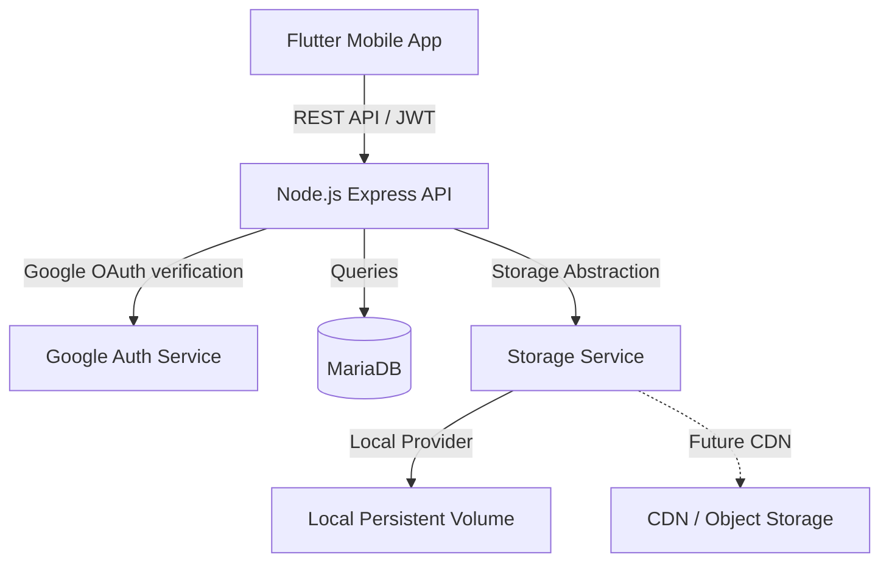

# Fixora Implementation Plan

This plan outlines the architecture, database schema, API specification, authentication flow, and deployment strategy for Fixora — a production-ready cross-platform Flutter application and Node.js backend.

## User Review Required

> [!IMPORTANT]
> This is a large-scale project involving both a mobile application and a backend infrastructure. Please review the architecture, database schema, and technical decisions outlined below before we begin the implementation phase.

## Open Questions

> [!WARNING]
> 1. **Google Maps API**: We need a valid Google Maps API Key to implement the location and nearby technician search functionality. Will you provide this when we start the Flutter app implementation?
> 2. **Firebase Project**: A Firebase project is required for Push Notifications (FCM). I will need you to set this up and provide the configuration details.
> 3. **Google OAuth Client**: Have you created the Google OAuth credentials for the Flutter app and Node.js backend?

## 1. Project Architecture

The system consists of two main components:
1. **Flutter Mobile Application**: Built with Clean Architecture, using Riverpod for state management, Dio for networking, and GoRouter for navigation.
2. **Node.js API Backend**: Built with Express.js, organized by features (Clean/Layered Architecture), using MariaDB for the database, and Docker for deployment.

### System Diagram



## 2. Authentication Flow

> [!NOTE]
> Authentication uses Google OAuth 2.0 for identity verification, but Fixora issues its own JWT tokens for API authorization.

1. **Flutter App**: User taps "Continue with Google".
2. **Google**: Returns identity data and token/ID token.
3. **Flutter App**: Sends the Google identity/token to the backend `/api/auth/google` endpoint.
4. **Backend**: 
   - Verifies the Google token.
   - Finds or creates the user in the `users` table.
   - Issues a Fixora JWT Access Token and Refresh Token.
5. **Flutter App**: Stores the tokens securely (using flutter_secure_storage).
6. **Subsequent API Calls**: Flutter includes the JWT Access Token in the `Authorization: Bearer <token>` header.

## 3. Storage Abstraction

The storage system will be abstracted to allow easy migration from local storage to a CDN or Object Storage in the future.

```typescript
// Conceptual Interface
interface StorageProvider {
  upload(file: File, entityType: string, entityId: string): Promise<StorageResult>;
  delete(storageKey: string): Promise<boolean>;
  getUrl(storageKey: string, visibility: 'public' | 'private'): string;
  exists(storageKey: string): Promise<boolean>;
}
```

The database `storage_files` table will store the `storage_key` and `storage_provider`. The backend will serve local files via a dedicated endpoint (`/storage/*`), and private files will require JWT authorization.

## 4. MariaDB Database Schema

### Core Tables

- `users`: Core identity (id, google_user_id, email, role, status, created_at)
- `customer_profiles`: Customer specific data (id, user_id, name, phone)
- `technician_profiles`: Technician specific data (id, user_id, name, phone, bio, verification_status, latitude, longitude, service_radius, rating)
- `service_categories`: Available categories (id, name, icon)
- `technician_services`: Mapping between technicians and categories (technician_id, category_id)

### Service & Job Tables

- `service_requests`: Customer requests (id, customer_id, category_id, description, status, latitude, longitude, urgency, preferred_time)
- `quotes`: Technician quotes for requests (id, request_id, technician_id, labor_cost, material_cost, total, duration, status)
- `jobs`: Accepted jobs (id, request_id, quote_id, status, scheduled_time, completed_time)
- `job_status_history`: History of job state changes (id, job_id, status, notes, changed_by, created_at)

### Supporting Tables

- `storage_files`: Central file registry (id, owner_id, entity_type, entity_id, storage_provider, storage_key, visibility)
- `reviews`: Customer reviews for technicians (id, job_id, rating, comment)
- `notifications`: User notifications (id, user_id, type, title, body, is_read)

## 5. REST API Specification (Initial MVP)

### Auth
- `POST /api/auth/google`: Authenticate and receive JWT
- `POST /api/auth/refresh`: Refresh JWT token

### Users & Profiles
- `GET /api/users/me`: Get current user profile
- `PUT /api/users/customer-profile`: Update customer profile
- `PUT /api/users/technician-profile`: Update technician profile
- `POST /api/users/technician-documents`: Upload verification documents

### Services
- `GET /api/categories`: List service categories
- `GET /api/technicians/nearby`: Search nearby verified technicians

### Service Requests & Jobs
- `POST /api/requests`: Create a new service request (customer)
- `GET /api/requests`: List requests (customer/technician)
- `POST /api/requests/:id/quotes`: Submit a quote (technician)
- `PUT /api/quotes/:id/accept`: Accept a quote (customer)
- `PUT /api/jobs/:id/status`: Update job status (technician/customer)

## 6. Docker Configuration

We will use Docker Compose to manage the Node.js API and MariaDB instances.

### `docker-compose.yml` Structure

- **db**: MariaDB service using a named volume for persistent database storage.
- **api**: Node.js service using a named volume mapping `/app/storage` to ensure uploaded files persist across container restarts.

## 7. Execution Plan (Phases)

### Phase 1: Backend Setup
- Initialize Node.js project (Express, TypeScript, Docker).
- Setup MariaDB and Database Schema (Prisma or Sequelize/Raw SQL).
- Implement Storage Abstraction.
- Implement Auth flow with Google OAuth.

### Phase 2: Backend Core API
- Implement User and Profile endpoints.
- Implement Service Categories and Nearby Search.
- Implement Requests, Quotes, and Jobs logic.

### Phase 3: Flutter Setup & Auth
- Initialize Flutter App (Riverpod, GoRouter, Dio).
- Implement Design System (Material 3).
- Implement Google Sign-In and Token Storage.

### Phase 4: Flutter MVP Features
- Implement Customer Flows (Requests, Compare Quotes).
- Implement Technician Flows (Dashboard, Submit Quotes, Job Status).
- Implement End-to-End Workflow testing.

## Verification Plan

### Automated Tests
- Backend API tests (Jest/Supertest) for core logic and state transitions (e.g., job statuses).
- Flutter Unit tests for Riverpod state and business logic.

### Manual Verification
- Execute the **End-to-End Acceptance Test** workflow outlined in the requirements.
- Verify Docker container restart preserves both MariaDB data and Local Storage files.
- Verify JWT tokens and authorization limits based on Roles (Customer vs Technician).
